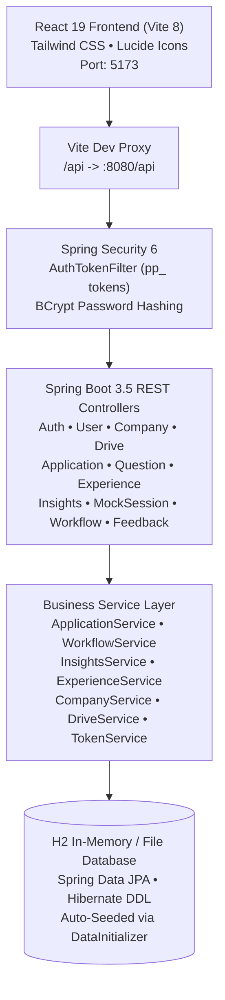

# PlacePrep — Smart Campus Placement Preparation Platform

> **Production-Grade SaaS Architecture • Grounded Placement Intelligence • Live Spring Boot REST API & React 19 Frontend**

PlacePrep is a comprehensive campus placement and hiring platform engineered to bridge the gap between academic theory and real-world recruitment drives. Designed for engineering undergraduates, university placement cells, and corporate recruiters, PlacePrep provides company-specific question banks, grounded historical analytics, active recall workspaces, application tracking, and an end-to-end recruitment pipeline.

---

## 🏛️ Platform Architecture Overview



### Technology Stack
* **Frontend**:
  * **Framework**: React 19 with JSX and functional hooks.
  * **Bundler & Tooling**: Vite 8 with ES Module hot reloading and proxy forwarding.
  * **Styling**: Vanilla Tailwind CSS 3 with custom tokens, modern glassmorphism, and responsive breakpoints.
  * **Design System**: 13 atomic UI components in `src/components/ui/` (`Button`, `Card`, `Badge`, `Input`, `Select`, `Dialog`, `Tabs`, `ProgressBar`, `Skeleton`, `EmptyState`, `ErrorState`, `PageHeader`, `Toast`).
  * **Icons**: Lucide React.
  * **Routing**: Hash router (`#dashboard`, `#companies`, `#company-hub`, `#drives`, `#applications`, `#dsa`, `#core-cs`, `#aptitude`, `#prep`, `#experiences`, `#ai-insights`, `#mock-interview`, `#workflow`, `#admin`, `#revision`) with deep linking and history synchronization.
* **Backend**:
  * **Language & Runtime**: Java 25.
  * **Framework**: Spring Boot 3.5.16, Spring Security, Spring Data JPA.
  * **Database**: H2 Database (`jdbc:h2:mem:placeprepdb`) seeded on startup via `DataInitializer.java`.
  * **Security**: Stateless cryptographic token issuance (`pp_<token>`), BCrypt password hashing, and role-based access control (`ROLE_ADMIN` vs `ROLE_STUDENT`).

---

## 🚀 Quick Start Guide

### Prerequisites
1. **Java Development Kit (JDK 21 or 25)**: Verify with `java -version`.
2. **Apache Maven (3.9+)**: Verify with `mvn -version`.
3. **Node.js (18+ or 22+) & npm**: Verify with `node -v` and `npm -v`.

---

### Step 1: Start the Spring Boot Backend

In your terminal, navigate to the `backend` directory:
```bash
cd backend
mvn spring-boot:run
```
* **Backend API Base**: `http://localhost:8080/api`
* **H2 Console**: `http://localhost:8080/h2-console`
  * **JDBC URL**: `jdbc:h2:mem:placeprepdb`
  * **Username**: `sa`
  * **Password**: *(leave blank)*

---

### Step 2: Start the React Frontend

In a separate terminal, navigate to the project root:
```bash
npm install
npm run dev
```
* **Frontend Application**: `http://localhost:5173/`
* API requests to `/api/*` are automatically forwarded to `http://localhost:8080/api` via the Vite proxy configured in `vite.config.js`.

---

### Step 3: Run the Test Suites

#### Backend Automated Tests (24 Passing Tests)
```bash
cd backend
mvn test
```
The test suite validates:
* `ApplicationServiceTest` (5 tests): Application tracking, authorization enforcement, stage progression, and KPI metrics.
* `WorkflowServiceTest` (5 tests): Candidate advancement across 4 rounds, elimination with reasons, shortlisting, final selection, and evaluation rubrics.
* `DriveServiceTest` (4 tests): Drive creation, batch filtering, property updates, and retirement.
* `ExperienceServiceTest` (5 tests): Experience retrieval, auto-ID generation, helpful voting, reporting, and moderation.
* `AuthServiceTest` (3 tests): User registration, demo login, and BCrypt encryption.
* `InsightsServiceTest` (2 tests): Statistical calculations grounded in database records without synthetic numbers.

#### Frontend Production Build
```bash
npm run build
```
Validates full TypeScript/JSX bundling, asset optimization, and CSS compilation with 0 errors.

---

## 🔑 Pre-Seeded Demo Accounts

The database is automatically pre-populated on boot via `backend/src/main/java/com/placeprep/config/DataInitializer.java`:

| Role | Email | Password | Access Level | One-Click Demo Button |
| :--- | :--- | :--- | :--- | :--- |
| **Placement Officer (Admin)** | `admin@placeprep.com` | `Admin@123` | `ROLE_ADMIN` | Top Navbar → **Demo Admin** |
| **Engineering Student** | `student@placeprep.com` | `Student@123` | `ROLE_STUDENT` | Top Navbar → **Demo Student** |

> [!NOTE]
> Demo accounts are intended for local development, faculty demonstrations, and end-to-end testing. In production environments, credentials should be configured via environment variables and production database secrets.

---

## 📦 Complete Feature Modules (8 of 8)

### 1. Placement Readiness Center (`#dashboard`)
* Transparent 100-point placement readiness rubric:
  * Questions Practiced: up to 40 points
  * Mock Session Average: up to 30 points
  * Company Hub Alignment: up to 15 points
  * Tracked Applications: up to 15 points
* Zero fabricated percentages or fake multipliers. Dynamic quick action shortcuts.

### 2. Placement Drive Tracker (`#drives` & `#applications`)
* Verified drive schedules (HCLTech, TCS Digital, Infosys, Deloitte, Accenture) with CTC, batch eligibility, and deadlines.
* Personal application lifecycle tracker (`INTERESTED` → `APPLIED` → `ASSESSMENT` → `INTERVIEW` → `OFFER` → `REJECTED` → `WITHDRAWN`).
* Real-time KPI metrics and stage notes update modal.

### 3. DSA & Coding Practice Studio (`#dsa`)
* Algorithmic coding studio organized by high-frequency interview patterns:
  * Arrays & Hashing • Two Pointers & Sliding Window • Linked Lists
  * Trees & Graphs • Dynamic Programming • Stacks & Queues
* Difficulty filters, solved tracking, and active recall flag shortcuts.

### 4. Core CS Technical Interview Studio (`#core-cs`)
* Dedicated preparation studio covering the 4 foundational pillars:
  * **DBMS**: SQL joins, indexing, ACID properties, normalization, transactions.
  * **OOP**: Polymorphism, dynamic dispatch, abstraction, SOLID principles, design patterns.
  * **Operating Systems**: Processes vs. threads, synchronization, deadlocks, virtual memory, paging.
  * **Computer Networks**: OSI model, TCP 3-way handshake, TCP vs UDP, DNS resolution, TLS/HTTPS.
* High-yield concept cheat sheets and direct links into practice mode.

### 5. Realistic Mock Test Center (`#mock-interview`)
* Three interview round simulations: Technical, HR (Behavioral / STAR), and Managerial.
* Realistic question timer, model answer reveal, and session history logging directly to Spring Boot database.

### 6. Interview Experience Community (`#experiences`)
* Student-submitted interview debriefs with verified questions, difficulty ratings, and preparation advice.
* Interactive "Helpful" upvoting with local session tracking.
* Content moderation flag modal for inappropriate or outdated question reporting.
* Platform feedback submissions connected to `FeedbackApi`.

### 7. AI Interview Coach & Analytics (`#ai-insights`)
* Statistical historical intelligence grounded in genuine database records.
* Platform overview metrics bar (8 recruiter hubs, 40+ vetted questions, verified student logs).
* Dynamic recruiter hub selection with live recalculation and preparation priority matrix.

### 8. Admin Console & Candidate Workflow Pipeline (`#admin` & `#workflow`)
* **Admin Control Panel**:
  * Recruiter profile creation, update, and deletion (`CompanyApi`).
  * Drive broadcasting and schedule management (`DriveApi`).
  * Technical question curation and bank indexing (`QuestionApi`).
  * Experience moderation gate (Approve / Reject) (`ExperienceApi.moderate`).
  * Student feedback and question report reviewing (`FeedbackApi`).
* **Candidate Selection Pipeline**:
  * 4-stage recruitment pipeline (`Aptitude` → `Technical` → `Managerial` → `HR`).
  * Candidate advancement, elimination with notes, shortlisting, and final offer selection.
  * Panel evaluation rubric logging with problem solving, technical depth, and communication ratings.

---

## 📡 REST API Specification

### Authentication & Users
* `POST /api/auth/register` — Register a new student account.
* `POST /api/auth/login` — Authenticate and receive `pp_<token>`.
* `POST /api/auth/demo-login` — 1-click token issuance for demo accounts (`student` or `admin`).
* `GET /api/users/me` — Retrieve current authenticated user profile and saved items.
* `PUT /api/users/me/batch` — Update graduation batch preference.
* `POST /api/users/me/toggle-saved-question/{id}` — Bookmark question.
* `POST /api/users/me/toggle-practiced-question/{id}` — Toggle solved status.
* `POST /api/users/me/toggle-revision-question/{id}` — Flag for active recall.

### Placement Drives & Applications
* `GET /api/drives?batch={batch}` — Catalog of upcoming drives with batch filtering.
* `POST /api/drives` *(Admin)* — Announce a new placement drive.
* `DELETE /api/drives/{id}` *(Admin)* — Retire a placement drive.
* `GET /api/applications/my` — Get authenticated student's tracked applications.
* `POST /api/applications` — Track drive application with stage status and notes.
* `PUT /api/applications/{id}/status` — Update recruitment stage.
* `DELETE /api/applications/{id}` — Withdraw application.
* `GET /api/applications/stats` — Summary metrics for student readiness score.

### Recruiter Hubs & Questions
* `GET /api/companies?batch={batch}` — List recruiter hubs.
* `GET /api/companies/{id}` — Detailed company overview and recruitment process.
* `POST /api/companies` *(Admin)* — Create company profile.
* `DELETE /api/companies/{id}` *(Admin)* — Remove company profile.
* `GET /api/questions?companyId={id}&round={round}&category={cat}` — Filtered question catalog.
* `POST /api/questions` *(Admin)* — Add question to verified bank.
* `DELETE /api/questions/{id}` *(Admin)* — Remove question from bank.

### Community Debriefs & Analytics
* `GET /api/experiences?companyId={id}&batch={batch}` — Verified interview experiences.
* `POST /api/experiences` — Submit interview debrief.
* `POST /api/experiences/{id}/vote` — Upvote helpful experience.
* `POST /api/experiences/{id}/report` — Flag inappropriate experience.
* `POST /api/experiences/{id}/moderate` *(Admin)* — Approve or reject experience.
* `GET /api/insights/overview` — Platform-wide intelligence metrics.
* `GET /api/insights/{companyId}` — Company-specific analytics and recurrence patterns.
* `POST /api/feedback` — Submit student platform feedback.

### Candidate Workflow Pipeline
* `GET /api/workflow/candidates?companyId={id}&round={round}` — Active recruitment candidates.
* `POST /api/workflow/candidates/{id}/advance?nextRound={round}` — Advance candidate to next round.
* `POST /api/workflow/candidates/{id}/eliminate?reason={reason}` — Eliminate candidate with notes.
* `POST /api/workflow/candidates/{id}/shortlist` — Shortlist candidate.
* `POST /api/workflow/candidates/{id}/select` — Extend final offer.
* `POST /api/workflow/candidates/{id}/evaluate` — Submit panel evaluation scores.

---

## 🔒 Security Architecture

1. **Stateless Token Verification**:
   * Custom `TokenService` issues cryptographic 32-byte tokens (`pp_<token>`).
   * `AuthTokenFilter` intercepts incoming requests, resolves Bearer tokens, and sets Spring `SecurityContext`.
2. **Role-Based Authorization**:
   * Admin mutation endpoints (`POST/PUT/DELETE /api/companies/**`, `/api/drives/**`, `/api/questions/**`, `/api/experiences/*/moderate`) are protected with `hasRole('ADMIN')`.
   * Public interaction endpoints (`POST /api/experiences/*/vote`, `POST /api/feedback`) are accessible without authentication to minimize friction.
   * Student endpoints (`/api/applications/**`, `/api/users/me/**`, `/api/mock-sessions/**`) require authentication.
3. **CORS & CSRF**:
   * Configured for seamless SPA development with credentials and standard HTTP verbs (`GET`, `POST`, `PUT`, `DELETE`, `OPTIONS`).
4. **Data Protection**:
   * Sensitive password hashes are stripped from `UserDto` and never serialized to clients.

---

## 📄 License & Attribution

Developed for college campus placement preparation and student readiness assessment. Grounded in authentic hiring transcripts and educational SaaS design standards.
